<!-- ZWART · GitHub profile -->

  

  

  

    
    
    
    
  

  Independent maker · AI & automation · Web & Android · 🇮🇩 Indonesia

Hello, I'm Zwart.
I turn ideas and everyday problems into software that's useful, simple, and approachable. I build web and Android apps, explore AI-powered workflows, and share experiments along the way.
Good software should feel effortless — even when building it isn't.

Selected work
<table>
  <tr>
    <td width="50%" valign="top">
      01 / AI &amp; DEVELOPER TOOLS
      <h3><a href="https://github.com/Zwart04/zwartflow">ZwartFlow</a></h3>
      
Model routing for AI coding agents. One workflow, multiple models.

    </td>
    <td width="50%" valign="top">
      02 / PRODUCTIVITY
      <h3><a href="https://github.com/Zwart04/daily-apps">Daily Apps</a></h3>
      
A shared workspace for projects, tasks, learning, and everyday operations.

    </td>
  </tr>
  <tr>
    <td width="50%" valign="top">
      03 / ANDROID
      <h3><a href="https://github.com/Zwart04/ZwartGuard">ZwartGuard</a></h3>
      
An Android project built with Kotlin.

    </td>
    <td width="50%" valign="top">
      04 / PERSONAL FINANCE
      <h3><a href="https://github.com/Zwart04/saku">Saku</a></h3>
      
An offline-first Android expense tracker designed for everyday simplicity.

    </td>
  </tr>
  <tr>
    <td width="50%" valign="top">
      05 / EXPERIMENTS
      <h3><a href="https://github.com/Zwart04/rakaat-counter">Rakaat Counter</a></h3>
      
A camera-assisted prayer counter that explores light and shadow detection.

    </td>
    <td width="50%" valign="top">
      06 / WEB EXPERIENCE
      <h3><a href="https://github.com/Zwart04/zwart-website">Zwart Website</a></h3>
      
My home on the web, where projects and experiments come together.

    </td>
  </tr>
</table>

<a href="https://github.com/Zwart04?tab=repositories">Browse all repositories ↗</a>

Toolbox

  
  

    <code>Web apps</code> · <code>Android</code> · <code>AI agents</code> · <code>Automation</code> · <code>Open source</code>
  

Activity

  
View contribution streak

   
  

    
  

  Made with curiosity. Refined with intention.
   
  <a href="https://zwart-website.pages.dev/">Website</a> · <a href="https://github.com/Zwart04?tab=repositories">Projects</a> · <a href="https://www.tiktok.com/@f.zwart">TikTok</a>

